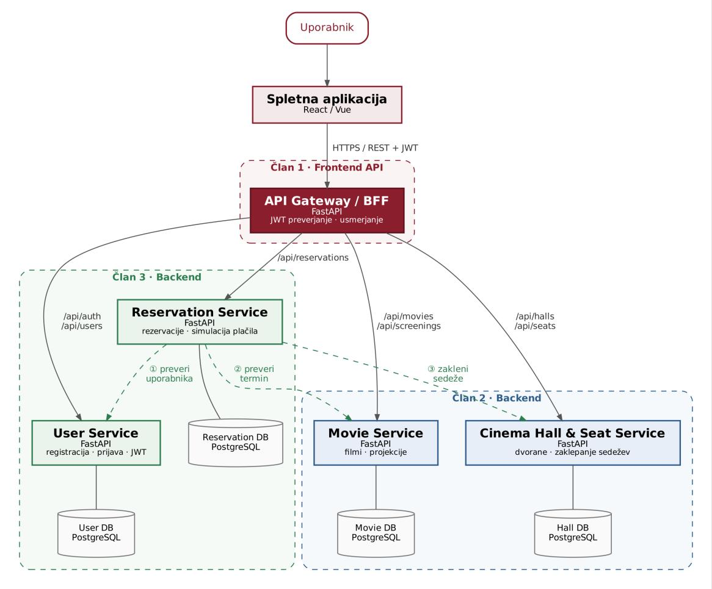

# 🎬 CineBook – rezervacija kino vstopnic

**Skupina:** sedež404 | **RV5**

CineBook je spletna aplikacija za rezervacijo kino vstopnic, zgrajena z mikrostoritvami. Uporabnik si ogleda filme, izbere projekcijo, izbere sedeže in jih rezervira. Plačilo je samo simulirano. Ko uporabnik izbere sedeže, se ti za nekaj minut zaklenejo, da jih ne more izbrati še kdo drug.

## Tehnologije

- **Backend:** Python, FastAPI
- **Baze:** PostgreSQL (vsaka storitev ima svojo bazo)
- **Frontend:** React / Vue
- **Avtentikacija:** JWT
- **Komunikacija med storitvami:** REST

## Ekipa in delitev dela

| Član | Mikrostoritve |
|------|---------------|
| Anja Popović | API Gateway (Frontend API) |
| Kristina Anđelković | Movie Service, Cinema Hall & Seat Service |
| Bor Silič | User Service, Reservation Service |

## Arhitektura



Frontend komunicira **samo** z API Gatewayem.

## Struktura repozitorija

```
cinebook/
├── api-gateway/          # Anja
├── movie-service/        # Kristina
├── seat-service/         # Kristina (Cinema Hall & Seat Service)
├── user-service/         # Bor
├── reservation-service/  # Bor
├── frontend/
└── README.md
```

Vsak dela v svoji mapi, tako se izognemo konfliktom.

## Mikrostoritve in API

### API Gateway – Anja Popović
Edina vstopna točka za frontend. Preveri JWT žeton in zahtevo pošlje naprej na pravo storitev. Nima svoje baze.

| Metoda | Pot | Opis |
|--------|-----|------|
| ANY | `/api/*` | posreduje zahtevo ustrezni storitvi |

### Movie Service – Kristina Anđelković
Hrani filme in termine projekcij. Baza: **Movie DB**.

| Metoda | Pot | Opis |
|--------|-----|------|
| GET | `/movies` | seznam filmov |
| GET | `/movies/{id}` | podrobnosti filma |
| POST | `/movies` | doda film |
| GET | `/screenings/{id}` | podatki o terminu |
| POST | `/screenings` | doda termin |

### Cinema Hall & Seat Service – Kristina Anđelković
Hrani dvorane in sedeže ter skrbi za začasno zaklepanje sedežev. Baza: **Hall DB**.

| Metoda | Pot | Opis |
|--------|-----|------|
| GET | `/halls` | seznam dvoran |
| GET | `/screenings/{id}/seats` | prosti in zasedeni sedeži |
| POST | `/seats/lock` | začasno zaklene sedeže |
| POST | `/seats/release` | sprosti sedeže |

### User Service – Bor Silič
Registracija in prijava uporabnikov. Ob prijavi vrne JWT žeton. Baza: **User DB**.

| Metoda | Pot | Opis |
|--------|-----|------|
| POST | `/register` | registracija |
| POST | `/login` | prijava, vrne JWT |
| GET | `/users/{id}` | podatki o uporabniku |

### Reservation Service – Bor Silič
Ustvari rezervacijo in simulira plačilo. Baza: **Reservation DB**.

| Metoda | Pot | Opis |
|--------|-----|------|
| POST | `/reservations` | nova rezervacija |
| GET | `/reservations/me` | moje rezervacije |
| POST | `/reservations/{id}/pay` | simulirano plačilo |
| DELETE | `/reservations/{id}` | preklic rezervacije |

## Potek rezervacije

Vse zahteve gredo čez API Gateway. Ko uporabnik naredi rezervacijo, Reservation Service preko REST klicev:

1. pri **User Service** preveri uporabnika,
2. pri **Movie Service** preveri termin,
3. pri **Cinema Hall & Seat Service** zaklene sedeže.

Če je vse v redu, se rezervacija shrani in uporabnik jo lahko plača.

## Zagon (lokalno)

Vsaka storitev se zažene posebej. Primer za eno storitev:

```bash
cd movie-service
pip install -r requirements.txt
uvicorn main:app --reload --port 8001
```

Predlagana vrata:

| Storitev | Vrata |
|----------|-------|
| API Gateway | 8000 |
| Movie Service | 8001 |
| Cinema Hall & Seat Service | 8002 |
| User Service | 8003 |
| Reservation Service | 8004 |

## Pravila za delo z Gitom

1. Pred začetkom dela vedno naredi **Pull**.
2. Delaj samo v svoji mapi.
3. Pogosto naredi **Commit** s kratkim opisom (npr. `dodan GET /movies`).
4. Na koncu naredi **Push**.
